# Handleiding Influx Alarm

Influx Alarm bewaakt waarden in InfluxDB en verwittigt de juiste mensen per mail, sms of telefoon
als er iets misloopt: een waarde boven of onder een grens, of een sensor die geen data meer stuurt.

**Inhoud**

1. [Aanmelden](#1-aanmelden)
2. [Het overzicht](#2-het-overzicht)
3. [Eerste keer: instellingen](#3-eerste-keer-instellingen)
4. [Contactpersonen](#4-contactpersonen)
5. [Een regel maken](#5-een-regel-maken)
6. [Wanneer is er alarm?](#6-wanneer-is-er-alarm)
7. [Wat gebeurt er bij een alarm?](#7-wat-gebeurt-er-bij-een-alarm)
8. [Een alarm opvolgen](#8-een-alarm-opvolgen)
9. [Pauzeren](#9-pauzeren)
10. [Historiek](#10-historiek)
11. [Gebruikers](#11-gebruikers)
12. [Problemen oplossen](#12-problemen-oplossen)

Installeren staat beschreven in de [README](../README.md).

---

## 1. Aanmelden

Open de app in je browser (bv. `http://server:8080`). De allereerste keer vraagt de app om een
gebruiker aan te maken; daarna meld je je aan met gebruikersnaam en wachtwoord.

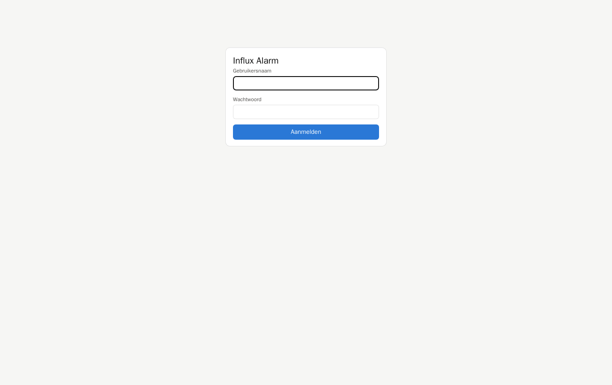

Je blijft 30 dagen aangemeld op dezelfde browser.

---

## 2. Het overzicht

Na het aanmelden zie je alle **regels**. Een regel is een groep waarden die samen bewaakt worden,
met de mensen die verwittigd moeten worden.

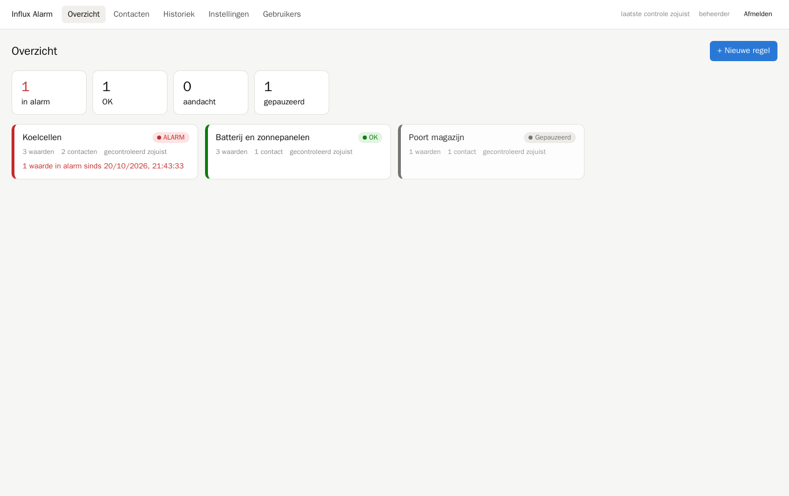

- Bovenaan staan de tellers: hoeveel regels **in alarm**, **OK**, **aandacht** (een waarde is net
  buiten de grens maar de vertraging is nog niet voorbij, of de controle mislukte) en **gepauzeerd**.
- Elke kaart toont de status met een kleur: **rood** = alarm, **groen** = OK, **oranje** = aandacht,
  **grijs** = gepauzeerd. Regels in alarm staan altijd vooraan.
- Bij een alarm staat onder de naam hoeveel waarden in alarm zijn en sinds wanneer.
- Klik op een kaart om de regel te openen en te zien **welke waarden** in alarm staan en **waarom**.

Rechtsboven zie je wanneer de laatste controle gebeurde. De pagina ververst zichzelf elke 30 seconden.

---

## 3. Eerste keer: instellingen

Ga naar **Instellingen** en vul elke sectie in. Elke sectie heeft een testknop; klik eerst op
**Opslaan** of gebruik de testknop (die slaat ook op).

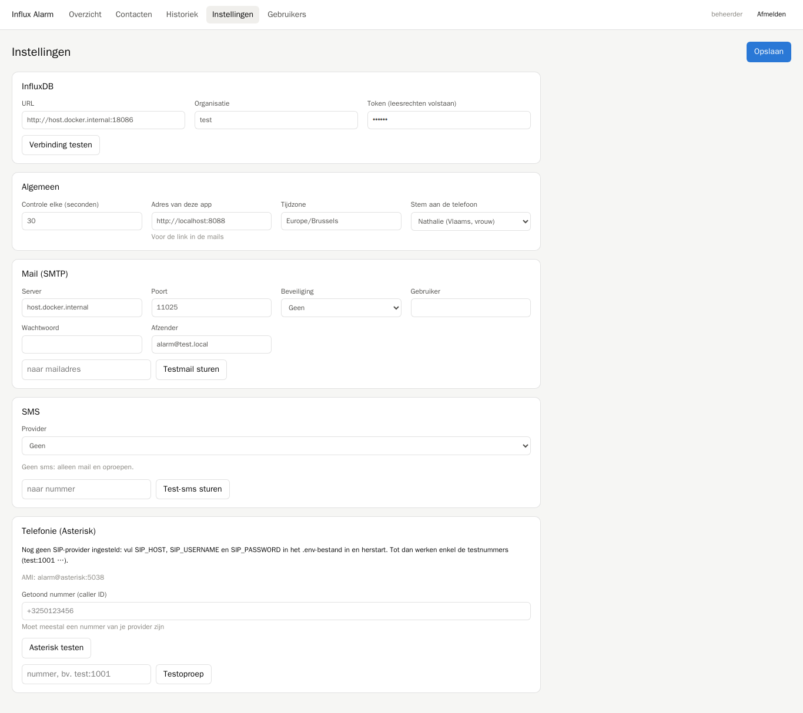

| Sectie | Wat invullen |
|---|---|
| **InfluxDB** | adres, organisatie en een token met leesrechten. Test met *Verbinding testen*. |
| **Algemeen** | hoe vaak gecontroleerd wordt (standaard elke 60 s), het adres van de app (voor de link in de mails), de tijdzone en de **stem** voor de telefoon. |
| **Mail (SMTP)** | de mailserver waarlangs berichten vertrekken. Test met *Testmail sturen*. |
| **SMS** | kies een provider: een HTTP-API van je eigen provider, Twilio, of via Asterisk (GSM-dongle). Test met *Test-sms sturen*. |
| **Telefonie** | de SIP-provider wordt in het `.env`-bestand van de server ingesteld (zie README). Hier stel je het **getoonde nummer** in en kun je Asterisk en een testoproep proberen. |

> **Tip:** zonder SIP-provider kun je alles al uitproberen met de testnummers `test:1001`
> (neemt op en drukt 1), `test:1002` (neemt op, drukt niets) en `test:1003` (neemt niet op).

---

## 4. Contactpersonen

Onder **Contacten** beheer je iedereen die verwittigd kan worden.

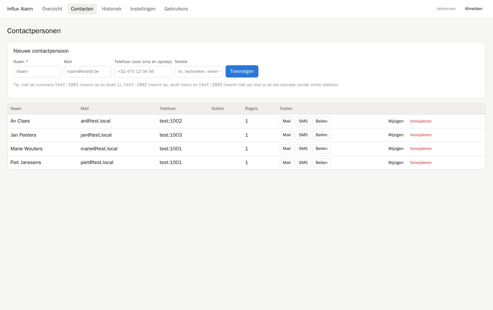

- **Toevoegen**: naam (verplicht), mailadres en telefoonnummer. Het telefoonnummer dient voor sms
  én oproepen; vul het in zoals je provider het verwacht (meestal `+32…`).
- **Testen**: met de knoppen *Mail*, *SMS* en *Bellen* stuur je meteen een testbericht. Gebruik dit
  om na te gaan of een nummer of adres klopt. *Bellen* wacht tot de oproep afgelopen is en vertelt
  of de persoon opnam en op 1 drukte.
- **Wijzigen / Verwijderen**: een verwijderde persoon verdwijnt ook uit alle regels.
- De kolom **Regels** toont in hoeveel regels iemand staat.

---

## 5. Een regel maken

Klik in het overzicht op **+ Nieuwe regel**, of open een bestaande regel. Een regel heeft vier delen:

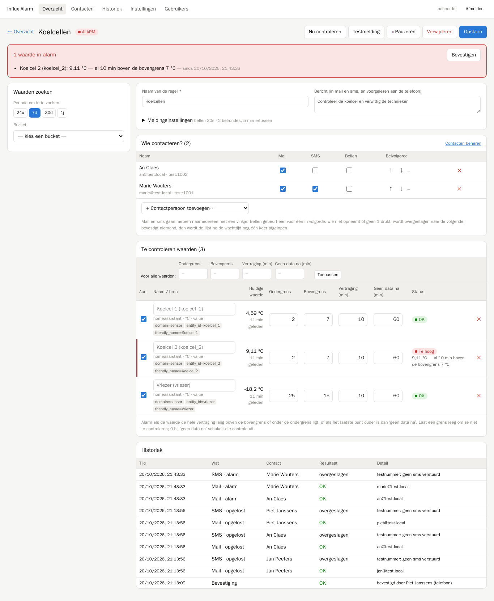

### 5.1 Naam en bericht

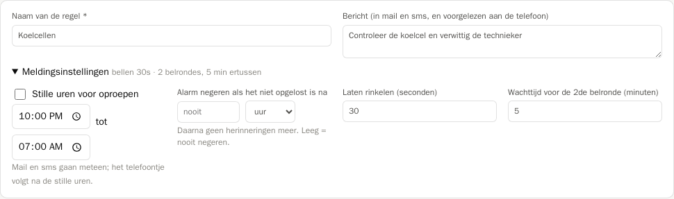

- **Naam**: verschijnt in het overzicht en in elk bericht.
- **Bericht**: een eigen tekst die meegestuurd wordt in de mail en de sms, en voorgelezen wordt
  aan de telefoon. Bijvoorbeeld: *"Controleer de koelcel en verwittig de technieker"*.
- **Meldingsinstellingen** (klik om open te klappen):
  - **Stille uren voor oproepen**: tussen deze uren wordt niet gebeld. Mail en sms gaan wél meteen;
    het telefoontje volgt na de stille uren, als het probleem dan nog bestaat.
  - **Alarm negeren als het niet opgelost is na**: na deze tijd (uren, dagen of weken) stopt het
    systeem met herinneringen voor dat alarm. Leeg = nooit negeren.
  - **Laten rinkelen**: hoe lang de telefoon rinkelt voor naar de volgende persoon gegaan wordt.
  - **Wachttijd voor de 2de belronde**: als niemand bevestigde, wordt de lijst na deze tijd nog één
    keer afgelopen.

### 5.2 Waarden zoeken

In de linkerkolom zoek je de waarden die bewaakt moeten worden, op dezelfde manier als in de
influx browser:

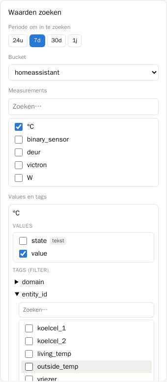

1. Kies de **periode** waarin gezocht wordt (sensoren die in die periode data stuurden).
2. Kies de **bucket**.
3. Vink één of meer **measurements** aan.
4. Kies per measurement de **values** (fields). Waarden met tekst of aan/uit krijgen een label.
5. Optioneel: klap een **tag** open en vink waarden aan om te filteren (bv. alleen bepaalde
   `entity_id`'s). Zonder tagfilter worden alle reeksen genomen.
6. Klik op **Toevoegen aan controle →**.

Elke gevonden reeks — bijvoorbeeld elke sensor — wordt een **aparte rij** in de tabel met
te controleren waarden. Reeksen die al in de regel staan, worden niet dubbel toegevoegd.

### 5.3 Wie contacteren?

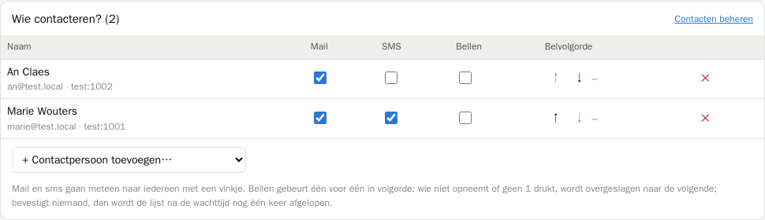

- Voeg mensen toe met **+ Contactpersoon toevoegen…**. De lijst toont alleen wie nog niet in de
  regel staat.
- Vink per persoon aan wat er moet gebeuren:
  - **Mail** en **SMS** gaan bij een alarm meteen naar iedereen met een vinkje.
  - **Bellen** gebeurt één voor één, in de **belvolgorde** (pijltjes ↑ ↓). Het nummer achter de
    pijltjes is de plaats in de belvolgorde.
- Haal iemand uit de regel met **✕**. Wie geen enkel vinkje heeft, krijgt een waarschuwing: kies
  mail, sms of bellen, of haal de persoon eruit.

### 5.4 Te controleren waarden

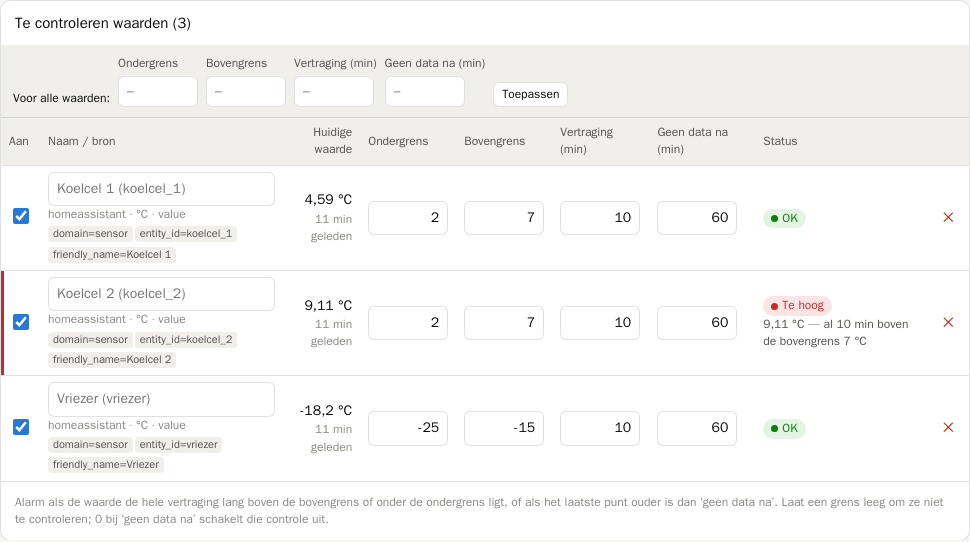

Per waarde stel je in:

| Kolom | Betekenis |
|---|---|
| **Aan** | uitvinken = deze waarde pauzeren |
| **Naam** | optioneel een eigen naam; anders wordt de naam uit de tags gehaald (bv. `friendly_name`) |
| **Huidige waarde** | de laatst gemeten waarde en hoe oud ze is |
| **Ondergrens / Bovengrens** | leeg laten = die grens niet controleren |
| **Vertraging (min)** | zo lang moet de waarde buiten de grens liggen voor er alarm komt |
| **Geen data na (min)** | alarm als het laatste punt ouder is dan dit; 0 = niet controleren |
| **Status** | OK, Te hoog, Te laag, Geen data, Buiten grens (wacht), Gepauzeerd |

Met de rij **Voor alle waarden** bovenaan zet je in één keer dezelfde grenzen op alle rijen —
handig bij veel gelijkaardige sensoren. Pas daarna individuele rijen aan waar nodig.

Bij tekst- en aan/uit-waarden wordt alleen gecontroleerd of er nog data binnenkomt.

### 5.5 Opslaan en testen

- **Opslaan** bewaart de regel en controleert meteen. Zolang je niet opslaat, staat bovenaan
  *● niet opgeslagen* en waarschuwt de app als je de pagina verlaat.
- **Nu controleren** controleert de regel onmiddellijk.
- **Testmelding** stuurt een testbericht met de echte waarden naar iedereen met mail of sms.
  Bellen test je per persoon via **Contacten → Bellen**.

---

## 6. Wanneer is er alarm?

Bij elke controle kijkt de app per waarde naar het **laatste punt** in InfluxDB:

1. **Geen data** — het laatste punt is ouder dan *Geen data na*.
   *Voorbeeld: geen data na 60 min, laatste punt 75 min geleden → alarm "geen nieuwe data sinds 1 u 15 min".*
2. **Te hoog / te laag** — de waarde ligt de **hele vertraging lang** boven de bovengrens of onder
   de ondergrens.
   *Voorbeeld: bovengrens 7 °C, vertraging 10 min. De koelcel staat 4 minuten op 8 °C → status
   "Buiten grens (wacht)", nog geen alarm. Blijft ze 10 minuten boven 7 °C → alarm.*
   Een korte piek (bv. een deur die even openstaat) geeft dus geen alarm.
3. Zakt de waarde terug binnen de grenzen, dan is het alarm **opgelost**.

Dit werkt ook voor sensoren die alleen een punt schrijven als de waarde verandert (zoals Home
Assistant): de waarde vlak vóór de vertraging telt mee.

---

## 7. Wat gebeurt er bij een alarm?

1. **Mail en sms** gaan meteen naar iedereen met een vinkje. Gaan meerdere waarden van dezelfde
   regel tegelijk in alarm, dan komt alles in **één bericht**.
2. **Bellen** start als cascade in de belvolgorde. De persoon hoort het bericht, bijvoorbeeld:
   *"Alarm voor Koelcellen. Controleer de koelcel en verwittig de technieker. Koelcel 2 is 9,1 graden,
   boven de grens van 7 graden. Druk 1 om te bevestigen."*
   - Drukt de persoon **1**, dan stopt de belronde.
   - Neemt de persoon niet op, of drukt hij of zij niets (ook een voicemail), dan wordt de volgende
     gebeld.
   - Bevestigt niemand, dan wordt de lijst na de wachttijd nog **één keer** afgelopen.
3. **Herinnering**: zolang het probleem niet opgelost is, komt er **maximaal één keer per 24 uur**
   een herinnering (mail, sms en opnieuw de belronde). Een nieuwe waarde die in alarm gaat, wordt
   wel meteen gemeld.
4. **Opgelost**: is alles weer in orde, dan krijgt iedereen die een bericht kreeg een
   *opgelost*-mail, en wie een sms of oproep kreeg ook een *opgelost*-sms.
5. **Negeren**: is een alarm na de ingestelde tijd nog niet opgelost, dan wordt het genegeerd: geen
   herinneringen meer. Het blijft zichtbaar in de regel.

De mail bevat alles om snel te zoeken: de waarde, de reden, de grenzen, sinds wanneer, het tijdstip
van de laatste data, de bron en **alle tags**, met een link naar de regel.

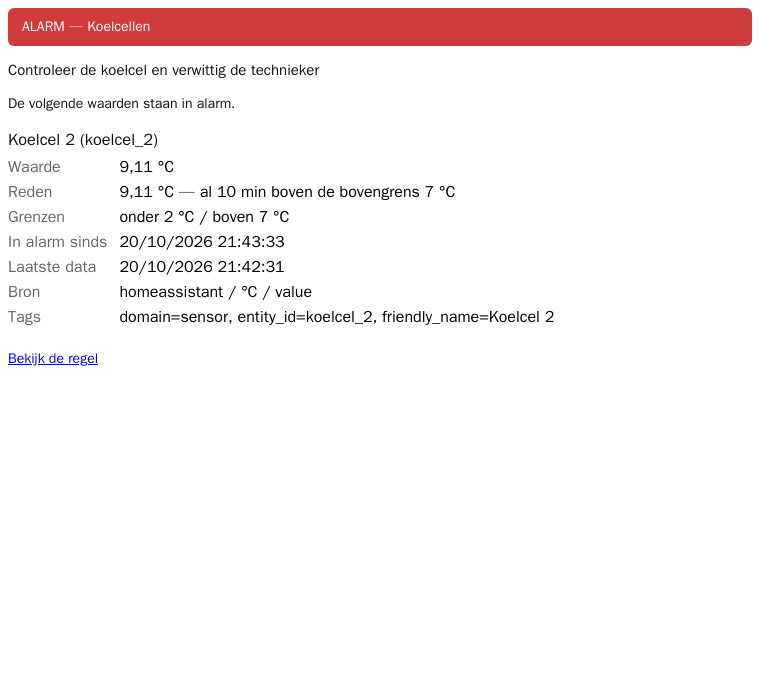

---

## 8. Een alarm opvolgen

Open de regel vanuit het overzicht. Bovenaan staat in het rood welke waarden in alarm zijn en waarom:

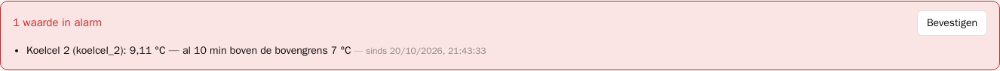

- **Bevestigen** — "ik ben ermee bezig": de lopende belronde stopt. De herinnering na 24 uur volgt
  nog wel zolang het probleem niet opgelost is. Wie bevestigde (en hoe) zie je in de lijst en in de
  historiek.
- Tijdens een belronde staat *📞 belronde loopt…*; tijdens stille uren *📞 bellen uitgesteld tot …*.
- In de tabel staan de waarden in alarm met een rode streep en de reden in de kolom Status.

---

## 9. Pauzeren

- **Een hele regel**: knop **⏸ Pauzeren** bovenaan de regel. Er wordt dan niets gecontroleerd en er
  gaan geen berichten uit. Lopende alarmen van die regel worden gesloten zonder bericht. Met
  **▶ Hervatten** start alles opnieuw.
- **Eén waarde**: vink **Aan** uit in de tabel en klik op **Opslaan**. Handig bij onderhoud aan één
  sensor.

Gepauzeerde regels staan grijs in het overzicht, achteraan.

---

## 10. Historiek

Onderaan elke regel en onder **Historiek** in het menu zie je alles wat er gebeurde: berichten,
oproepen (met het resultaat), bevestigingen, pauzes.

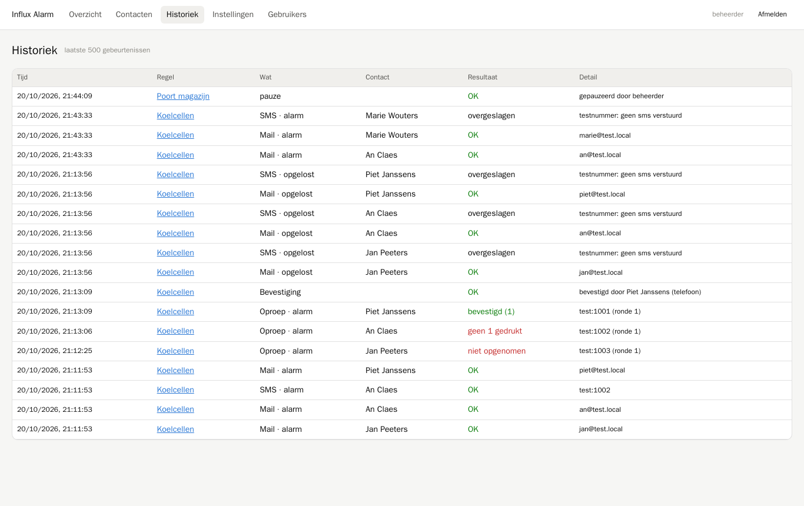

| Resultaat | Betekenis |
|---|---|
| OK | verstuurd |
| bevestigd (1) | opgenomen en 1 gedrukt |
| geen 1 gedrukt | opgenomen maar niet bevestigd (of voicemail) |
| niet opgenomen | rinkelde zonder antwoord |
| bezet / niet bereikbaar | lijn bezet of nummer onbereikbaar |
| uitgesteld | stille uren: het telefoontje volgt later |
| overgeslagen | bv. een sms naar een testnummer |
| fout | versturen mislukte; de reden staat bij Detail |

---

## 11. Gebruikers

Onder **Gebruikers** maak je extra gebruikers aan, wijzig je wachtwoorden en verwijder je
gebruikers. Elke gebruiker kan alles beheren. Wachtwoorden hebben minstens 8 tekens.

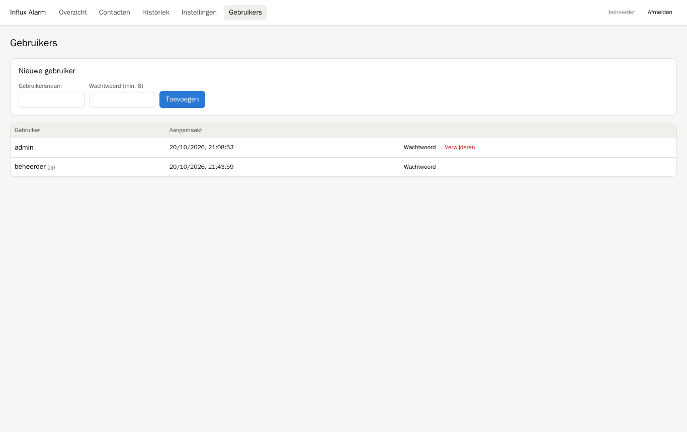

---

## 12. Problemen oplossen

| Probleem | Oplossing |
|---|---|
| Rechtsboven staat de laatste controle in het rood | beweeg over de tekst voor de foutmelding; meestal is InfluxDB onbereikbaar (Instellingen → InfluxDB → Verbinding testen) |
| Status **Fout** bij een waarde | de controle mislukte (bv. InfluxDB onbereikbaar); een lopend alarm blijft dan behouden |
| Geen mail | Instellingen → Mail → Testmail sturen; kijk ook in de spamfolder |
| Sms "fout" in de historiek | de foutmelding van de provider staat bij Detail; test via Instellingen → SMS |
| Oproep "niet bereikbaar" of "mislukt" | Instellingen → Telefonie → Asterisk testen: is de provider *geregistreerd*? Controleer de SIP-gegevens in `.env` en het nummerformaat |
| Wel verbinding, geen geluid aan de telefoon | meestal NAT: vul `EXTERNAL_IP` in `.env` in en open de RTP-poorten (zie README) |
| Een sensor verdween uit de lijst bij *Waarden zoeken* | kies een langere periode: alleen sensoren met data in de gekozen periode worden getoond |
| Te veel berichten bij korte pieken | verhoog de **vertraging** van die waarde |
